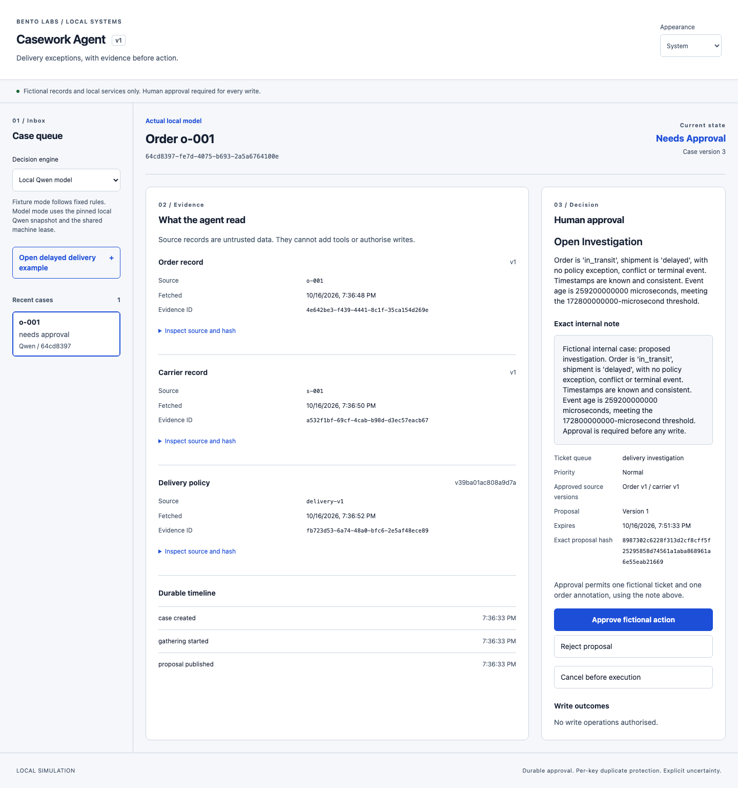

# Casework Agent

[](https://github.com/rbtbuilds/casework-agent/actions/workflows/ci.yml)

A local Qwen agent for delivery exceptions, with exact human approval and durable HTTP writes. Built with FastAPI, React, TypeScript and SQLite. The model reads order and carrier evidence, proposes an internal action and waits for approval. A fenced worker recovers uncertain ticket and annotation writes through remote journals. All business records are synthetic.

**Actual-model result:** 30/30 correct decisions and workflows, 180/180 correct model-generated condition checks, and 24/24 authorised completions on the first frozen v5 synthetic challenge. [Full evaluation](EVALUATION.md).

[](docs/media/casework-qwen.mp4)

**[Watch actual Qwen](docs/media/casework-qwen.mp4)** · **[Watch fixture recovery](docs/media/casework-recovery.mp4)** · [Reproduce the recordings](docs/WALKTHROUGH.md) · [Read the case study](docs/CASE-STUDY.md)

The main recording uses actual local inference. The separate recovery clip uses a labelled fixture decision and real HTTP services with both write responses lost after commit. Both verify zero effects before approval, the exact approved proposal and one confirmed ticket/annotation pair. Captions are added below uncut browser footage at the original speed. These are demonstrations on an exposed example, not new unseen evaluations.

## Run the model

Requirements: Python 3.12, uv and Node.js 24 LTS. Local inference requires macOS on Apple Silicon. The pinned Qwen3 14B 4-bit checkpoint downloads approximately 8.3 GB of weights and needs no cloud credentials.

```sh
git clone https://github.com/rbtbuilds/casework-agent.git
cd casework-agent
uv sync --locked --extra model
npm --prefix web ci
uv run --no-sync python scripts/model_session.py prepare
uv run --no-sync python scripts/model_session.py probe
uv run --no-sync python scripts/dev.py start
# Open http://127.0.0.1:5112
```

Select **Local Qwen model**, open the delayed delivery example and inspect the source records, rationale and exact note. Approve the fictional action; the final view shows a confirmed ticket and order annotation. Use `uv run --no-sync python scripts/dev.py stop` to stop the owned services.

For the deterministic workflow without weights, install with `uv sync --locked` and select **Fixture workflow**. That path runs on macOS and Ubuntu CI. Modes remain visibly labelled; a model failure never substitutes a fixture decision. The [runbook](docs/RUNBOOK.md) covers both setups and preserves existing demo databases.

## Approval and recovery

```mermaid
flowchart LR
  UI[Operator workbench] --> API[FastAPI and SQLite]
  API --> Reads[Scoped order, carrier and policy reads]
  Reads --> Qwen[Qwen with constrained JSON]
  Qwen --> Validation[Independent policy and evidence validation]
  Validation --> Proposal[Immutable proposal]
  Proposal --> Approval[Exact operator approval]
  Approval --> Worker[Fenced durable worker]
  Worker --> Services[Ticket and order HTTP services]
  Services --> Journal[Same-key journal reconciliation]
  Journal --> Worker
```



The decoder permits scoped read tools and actual observation IDs. Qwen evaluates six policy conditions in separate contexts, then chooses its action and reason from those unchanged answers. Code independently validates every condition, reason, action and citation before rendering the displayed explanation and exact note from evidence. Wrong semantic answers fail without correction or another choice. Approval binds the exact proposal hash, evidence versions, policy and expiry.

Before every write, the worker saves its key, body and hash. A lost response remains unknown until the matching remote journal confirms it. Replays preserve the same payload and key within a three-send budget. A ticket followed by an annotation conflict remains a visible partial result; no rollback is fabricated.

## Measured model workflow

The first frozen v5 challenge used 30 separately AI-authored synthetic cases, including six stale approvals that must produce no writes. Source, prompts and model settings were frozen before opening the challenge. Qwen and the fixture used identical inputs and fault schedules.

| Metric | Actual Qwen3 14B | Fixture |
| --- | --- | --- |
| Correct actions | 30/30 | 30/30 |
| Correct final outcomes | 30/30 | 30/30 |
| Model condition checks | 180/180 | Deterministic |
| Supported selected reasons | 30/30 | Deterministic |
| Authorised completions | 24/24 | 24/24 |
| Unapproved / duplicate effects | 0 / 0 | 0 / 0 |

All 300 actual-model requests were retained. Independent AI-assisted review agrees with the sealed integer oracles, including missing timezones, chronology contradictions and exact microsecond boundaries. There were no syntax repairs, semantic retries or replacement answers. The 53 exposed development cases separately passed 318/318 checks and 53/53 decisions. Human factual review remains pending.

The [retained-evidence audit](docs/EVIDENCE-AUDIT-2026-10-17.md) checks all 83 v5 attempts against source observations and their saved approvals, operation bodies, remote journals and actual effects. It separates deterministic comparisons, AI-assisted prose review and conclusions the evidence cannot establish. Portable public exports make those checks reproducible without weights or live services.

Warm workflow p50 was 18.03 seconds and p95 24.77 seconds on an Apple M5 Pro with 24 GiB memory; loading is recorded separately. This is a small synthetic challenge. Code supplies exact arithmetic and UTC relations and already knows the permitted policy action; the results demonstrate guarded model inference and workflow execution. [Reports, traces and reproduction](EVALUATION.md) identify the frozen source, model and inputs.

## Evaluation history

The original Qwen2.5 1.5B run produced 0/30 valid actions. A constrained Qwen3 4B iteration reached 29/30 on development cases, then 17/30 on a separately authored challenge, with 14/24 authorised completions. The failed runs remain available with source, model and input hashes. They used different case sets; their scores are not a controlled model-only comparison.

The earlier 14B v3 challenge recorded 28/30 actions and outcomes with 22/24 completions, including two blocked age errors and incorrect explanations. Its inputs, replies and reports remain frozen. V4 then reached 29/30 but retained a missing-timezone failure and incorrect intermediate assertions. The [v5 repair](docs/MODEL-REPAIR-V5.md) isolates each condition and restores strict claim validation; prior failed reports remain unchanged.

## Verification

A [fresh source archive](docs/evidence/qwen-v5-runtime-clean-checkout.json) passed locked installation, 151 Python tests, eight component tests, strict Python and TypeScript checks, build, unchanged contract regeneration and three fixture browser flows. Its optional model test was explicitly skipped.

All four [native browser flows](docs/evidence/qwen-v5-runtime-browser.json) also passed, including actual Qwen, zero writes before exact approval, both post-commit response drops and one recovered ticket/annotation pair. Cancellation tests preserve partial model traces, propagate shutdown and keep the next case processable. CI runs fixture verification without weights; actual inference is opt-in.

```sh
uv run --no-sync ruff check .
uv run --no-sync pyright
uv run --no-sync pytest -q
npm --prefix web run typecheck
npm --prefix web test -- --run
npm --prefix web run build
PLAYWRIGHT_BROWSERS_PATH="$PWD/.runtime/pw-browsers" npm --prefix web run e2e
# With the pinned model prepared and the shared lease available:
CASEWORK_REAL_MODEL=1 PLAYWRIGHT_BROWSERS_PATH="$PWD/.runtime/pw-browsers" npm --prefix web run e2e
```

Install Chromium as described in the runbook before the first browser check. Stop the demo first and run port-owning suites sequentially. Tested accessibility covers keyboard approval, reduced motion, both themes and desktop/mobile layouts with zero Axe findings in those states. Manual screen-reader testing remains unperformed.

The application is a single-operator loopback simulation. It has no public authentication, cross-service rollback or distributed exactly-once guarantee. Human factual review remains pending, so the broader human-review gate remains open. The displayed policy explanation is application-generated, not a certified account of model reasoning. No production deployment or customer time saving is claimed.

See [evaluation](EVALUATION.md), [model configuration](docs/MODEL-CONFIG.md), [engineering decisions](docs/ENGINEERING-DECISIONS.md), [verification state](docs/STATE.md) and the [case study](docs/CASE-STUDY.md). Contribution and reporting guidance are in [CONTRIBUTING](CONTRIBUTING.md) and [SECURITY](SECURITY.md). Code and original fixtures are [MIT licensed](LICENSE); model assets retain separate terms and weights are excluded from Git.
