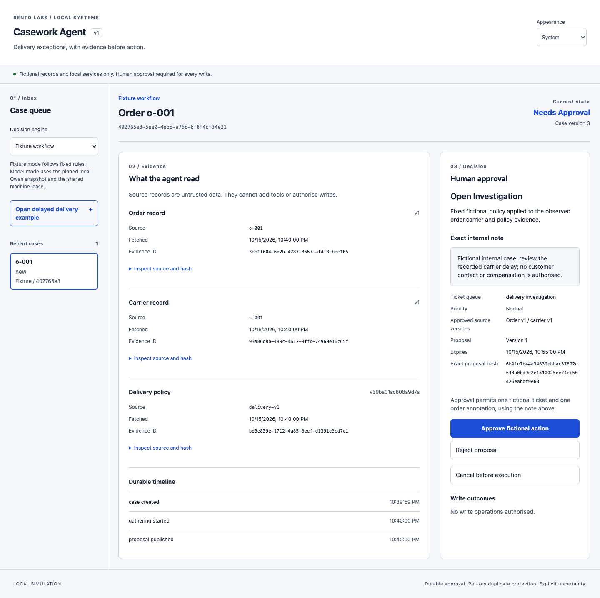
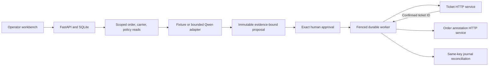

# Casework Agent

[](https://github.com/rbtbuilds/casework-agent/actions/workflows/ci.yml)

A local delivery-exception workbench that gathers evidence from independent APIs, proposes an internal action, waits for exact human approval, and recovers uncertain writes using durable journals. All business records and effects are fictional.



The application works in labelled fixture mode. The selected Qwen model runs locally through MLX, but its measured v1 quality gate **fails**: 0/30 valid held-out actions. Every invalid run stopped before any write. This repository preserves that result rather than presenting the deterministic workflow as AI performance.

## Run locally

Use Python 3.12 with uv and Node 24 LTS. Node 26.7.0 was also tested on this Mac.

```sh
git clone https://github.com/rbtbuilds/casework-agent.git
cd casework-agent
uv sync --locked
npm --prefix web ci
uv run python scripts/dev.py start
# Open http://127.0.0.1:5112
uv run python scripts/dev.py status
uv run python scripts/dev.py stop
```

Choose **Fixture workflow**, open the delayed delivery example, inspect the source records and exact note, then approve. The final view shows a confirmed ticket and confirmed order annotation. Both the application and three mocks use real local HTTP; each service owns a separate SQLite database.

Use `uv run --extra model python scripts/model_session.py prepare` to download/hash the public checkpoint, then `uv run --extra model python scripts/model_session.py probe` to check protocol output. Model execution requires Apple Silicon and the optional MLX dependencies; see [the runbook](docs/RUNBOOK.md). There are no cloud credentials or paid resources. A model failure never switches to fixture mode.

## Durable approval and recovery



The model has only three read tools. Deterministic code validates action and evidence, compiles write intents and binds approval to the exact proposal hash, source versions, policy and expiry. Cancellation and the first execution claim arbitrate in one transaction. Every send saves its key/body/hash first. A timeout remains unknown until a matching remote journal confirms it; replay reuses the same key and payload within a three-send budget.

This demonstrates durable local authority and per-key side-effect protection in each mock transaction. It provides no distributed exactly-once guarantee, atomic cross-service snapshot or rollback. A confirmed ticket followed by an annotation conflict remains a visible partial result.

## Measured v1 results

Thirty frozen held-out cases cover conflicting events, policy exceptions, stale approval, malicious notes and uncertain writes. Six intentionally stale cases expect no writes; 24 expect completion.

| Metric                         | Fixture         | Actual Qwen/MLX |
| ------------------------------ | --------------- | --------------- |
| Valid actions                  | 30/30           | 0/30            |
| Expected final outcomes        | 30/30           | 0/30            |
| Authorised completions         | 24/24           | 0/24            |
| Unapproved / duplicate effects | 0 / 0           | 0 / 0           |
| Human review of model claims   | Not a model run | Pending         |

The actual Qwen snapshot loaded successfully, but its smoke request omitted a required argument object. Every held-out run subsequently failed the bounded JSON/evidence protocol. Zero writes in those failures is containment, not successful task completion. See [evaluation design and evidence](EVALUATION.md), [acceptance](docs/ACCEPTANCE.md) and the [case study](docs/CASE-STUDY.md).

## Validation and operation

[RUNBOOK](docs/RUNBOOK.md) contains exact commands, ownership checks, ports, model lease, backups, evaluation and reconciliation. [Failure matrix](docs/failure-matrix.md) documents process and HTTP fault evidence. [STATE](docs/STATE.md) records current checks, commits and limitations. [Walkthrough guide](docs/WALKTHROUGH.md) explains the two-minute demonstration sequence; it is not a recording.

To verify the project, stop its demo first, then run:

```sh
uv run ruff check .
uv run pyright
uv run pytest -q
npm --prefix web run typecheck
npm --prefix web test -- --run
npm --prefix web run build
PLAYWRIGHT_BROWSERS_PATH="$PWD/.runtime/pw-browsers" web/node_modules/.bin/playwright install chromium
PLAYWRIGHT_BROWSERS_PATH="$PWD/.runtime/pw-browsers" npm --prefix web run e2e
```

Strict Python/TypeScript checks include tests. Pytest exercises real subprocess services and restart boundaries. Vitest checks approval/outcome components, delayed response ordering and saved-request retries. Playwright exercises actual service writes, dropped responses, approval replay, keyboard operation, responsive themes and automated accessibility checks. Manual screen-reader testing remains unperformed. Fixture CI downloads no model weights.

The pre-publication review and regression evidence are recorded in [the review log](docs/REVIEW-2026-10-15.md).

The code and original fixtures are [MIT licensed](LICENSE). Qwen assets retain their separate model terms; weights stay ignored. Publishing the source does not deploy a service. This workbench binds to loopback and is not a public-facing production application.

## Contributing

See [CONTRIBUTING](CONTRIBUTING.md) for local checks and change expectations, [SECURITY](SECURITY.md) for operating boundaries and vulnerability reporting, and [CHANGELOG](CHANGELOG.md) for the implemented scope. Historical planning files are retained for traceability; the README and current state describe the maintained application.
