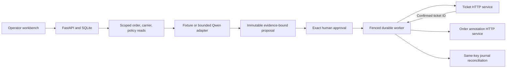

# Casework Agent

[](https://github.com/rbtbuilds/casework-agent/actions/workflows/ci.yml)

A human-approved agent workflow for delivery exceptions, built with FastAPI, React, TypeScript and SQLite. It gathers evidence from independent order and carrier APIs, proposes an internal action, and recovers interrupted ticket and annotation writes through durable journals. The demo uses synthetic business records.


**Current status:** the deterministic fixture workflow passes the 30-case held-out evaluation. The experimental Qwen/MLX adapter scored 0/30 valid actions; invalid outputs stopped before any write. Both results are published with traces and reproducible inputs below.

## Run locally

Requirements: **Python 3.12**, **uv** and **Node.js 24 LTS**. The fixture workflow is verified on macOS and in Ubuntu CI. Optional model inference requires macOS on Apple Silicon.

```sh
git clone https://github.com/rbtbuilds/casework-agent.git
cd casework-agent
uv sync --locked
npm --prefix web ci
uv run python scripts/dev.py start
# Open http://127.0.0.1:5112
uv run python scripts/dev.py status
uv run python scripts/dev.py stop
```

Choose **Fixture workflow**, open the delayed delivery example, inspect the source records and exact note, then approve. The final view shows a confirmed ticket and confirmed order annotation. The application calls three independent HTTP services, each backed by its own SQLite database.

Use `uv run --extra model python scripts/model_session.py prepare` to download/hash the public checkpoint, then `uv run --extra model python scripts/model_session.py probe` to check protocol output. See [model setup and evaluation](docs/RUNBOOK.md#local-qwen) for the optional MLX dependencies. The demo requires no cloud credentials. A model failure remains visible; fixture mode is selected explicitly.

## Durable approval and recovery



The model has only three read tools. Deterministic code validates action and evidence, compiles write intents and binds approval to the exact proposal hash, source versions, policy and expiry. Cancellation and the first execution claim arbitrate in one transaction. Every send saves its key/body/hash first. A timeout remains unknown until a matching remote journal confirms it; replay reuses the same key and payload within a three-send budget.

This demonstrates durable local authority and per-key side-effect protection in each mock transaction. It provides no distributed exactly-once guarantee, atomic cross-service snapshot or rollback. A confirmed ticket followed by an annotation conflict remains a visible partial result.

## Measured v1 results

Thirty frozen held-out cases cover conflicting events, policy exceptions, stale approval, malicious notes and uncertain writes. Six intentionally stale cases expect no writes; 24 expect completion.

| Metric                         | Fixture         | Actual Qwen/MLX |
| ------------------------------ | --------------- | --------------- |
| Valid actions                  | 30/30           | 0/30            |
| Expected final outcomes        | 30/30           | 0/30            |
| Authorised completions         | 24/24           | 0/24            |
| Unapproved / duplicate effects | 0 / 0           | 0 / 0           |
| Human review of model claims   | Not a model run | Pending         |

The actual Qwen snapshot loaded successfully, but its smoke request omitted a required argument object. Every held-out run subsequently failed the bounded JSON/evidence protocol. Zero writes in those failures is containment, not successful task completion. See [evaluation design and evidence](EVALUATION.md), [acceptance](docs/ACCEPTANCE.md) and the [case study](docs/CASE-STUDY.md).

## Validation and operation

The [runbook](docs/RUNBOOK.md) covers setup, process lifecycle, model execution, backups and recovery. For implementation detail, see [engineering decisions](docs/ENGINEERING-DECISIONS.md), the [failure matrix](docs/failure-matrix.md) and [verification status](docs/STATE.md). A [walkthrough guide](docs/WALKTHROUGH.md) describes the demonstration sequence.

To verify the project, stop its demo first, then run:

```sh
uv run ruff check .
uv run pyright
uv run pytest -q
npm --prefix web run typecheck
npm --prefix web test -- --run
npm --prefix web run build
PLAYWRIGHT_BROWSERS_PATH="$PWD/.runtime/pw-browsers" web/node_modules/.bin/playwright install chromium
PLAYWRIGHT_BROWSERS_PATH="$PWD/.runtime/pw-browsers" npm --prefix web run e2e
```

Strict Python/TypeScript checks include tests. Pytest exercises real subprocess services and restart boundaries. Vitest checks approval/outcome components, delayed response ordering and saved-request retries. Playwright exercises actual service writes, dropped responses, approval replay, keyboard operation, responsive themes and automated accessibility checks. Manual screen-reader testing remains unperformed. Fixture CI downloads no model weights.

The workbench is a single-operator simulation bound to loopback. It has no public authentication or cross-service rollback. The code and original fixtures are [MIT licensed](LICENSE); Qwen assets retain their separate model terms. Model weights are excluded from the repository.

## Contributing

See [CONTRIBUTING](CONTRIBUTING.md) for local checks and change expectations, [SECURITY](SECURITY.md) for operating boundaries and vulnerability reporting, and [CHANGELOG](CHANGELOG.md) for the implemented scope. The [design specification](docs/SPEC.md) and [original implementation plan](docs/superpowers/plans/2026-10-15-v1.md) retain the design history.
