# Casework Agent

[](https://github.com/rbtbuilds/casework-agent/actions/workflows/ci.yml)

A local Qwen agent for delivery exceptions, with exact human approval and durable HTTP writes. Built with FastAPI, React, TypeScript and SQLite. The model reads order and carrier evidence, proposes an internal action and waits for approval. A fenced worker recovers uncertain ticket and annotation writes through remote journals. All business records are synthetic.

**Actual-model result:** 29/30 correct workflows and 23/24 authorised completions on the first frozen v4 synthetic challenge. Displayed explanations are generated from evidence; intermediate model claims retain known errors. [Full evaluation](EVALUATION.md).


## Run the model

Requirements: Python 3.12, uv and Node.js 24 LTS. Local inference requires macOS on Apple Silicon. The pinned Qwen3 14B 4-bit checkpoint downloads approximately 8.3 GB of weights and needs no cloud credentials.

```sh
git clone https://github.com/rbtbuilds/casework-agent.git
cd casework-agent
uv sync --locked --extra model
npm --prefix web ci
uv run --no-sync python scripts/model_session.py prepare
uv run --no-sync python scripts/model_session.py probe
uv run --no-sync python scripts/dev.py start
# Open http://127.0.0.1:5112
```

Select **Local Qwen model**, open the delayed delivery example and inspect the source records, rationale and exact note. Approve the fictional action; the final view shows a confirmed ticket and order annotation. Use `uv run --no-sync python scripts/dev.py stop` to stop the owned services.

For the deterministic workflow without weights, install with `uv sync --locked` and select **Fixture workflow**. That path runs on macOS and Ubuntu CI. Modes remain visibly labelled; a model failure never substitutes a fixture decision. The [runbook](docs/RUNBOOK.md) covers both setups and preserves existing demo databases.

## Approval and recovery

```mermaid
flowchart LR
  UI[Operator workbench] --> API[FastAPI and SQLite]
  API --> Reads[Scoped order, carrier and policy reads]
  Reads --> Qwen[Qwen with constrained JSON]
  Qwen --> Validation[Independent policy and evidence validation]
  Validation --> Proposal[Immutable proposal]
  Proposal --> Approval[Exact operator approval]
  Approval --> Worker[Fenced durable worker]
  Worker --> Services[Ticket and order HTTP services]
  Services --> Journal[Same-key journal reconciliation]
  Journal --> Worker
```



The decoder permits scoped read tools and actual citation IDs. Qwen generates a six-condition intermediate assessment and chooses the action. Code validates the chosen action and writes the displayed policy explanation and exact note from observed facts. Intermediate assessment errors remain visible in diagnostics; they cannot alter the explanation or authorise writes. Approval binds the exact proposal hash, evidence versions, policy and expiry.

Before every write, the worker saves its key, body and hash. A lost response remains unknown until the matching remote journal confirms it. Replays preserve the same payload and key within a three-send budget. A ticket followed by an annotation conflict remains a visible partial result; no rollback is fabricated.

## Measured model workflow

The first frozen v4 challenge used 30 new synthetic cases, including six stale approvals that must produce no writes. The fixture and Qwen runs used identical inputs and fault schedules.

| Metric | Actual Qwen3 14B | Fixture |
| --- | --- | --- |
| Correct actions | 29/30 | 30/30 |
| Correct final outcomes | 29/30 | 30/30 |
| Authorised completions | 23/24 | 24/24 |
| Unapproved / duplicate effects | 0 / 0 | 0 / 0 |

The numerical targets are 27/30 actions, 27/30 outcomes and 22/24 completions. Warm workflow p50 was 22.59 seconds and p95 24.39 seconds on an Apple M5 Pro with 24 GiB memory; loading is recorded separately. This is a small synthetic challenge, not an industrial benchmark. [Reports, traces and reproduction](EVALUATION.md) identify the frozen source, model and inputs.

Code supplies exact age arithmetic and UTC comparisons, validates the model's action, and writes the displayed explanation from evidence. One missing-timezone decision failed action validation before a proposal, approval or writes. The fresh run retains 2 incorrect intermediate assessment fields across 2 attempts and 2 unsupported selected reasons. These are recorded in trace diagnostics and cannot change displayed explanations or authorise writes. Human review remains pending; the broader zero-unsupported-claims gate is not claimed.

## Evaluation history

The original Qwen2.5 1.5B run produced 0/30 valid actions. A constrained Qwen3 4B iteration reached 29/30 on development cases, then 17/30 on a separately authored challenge, with 14/24 authorised completions. The failed runs remain available with source, model and input hashes. They used different case sets; their scores are not a controlled model-only comparison.

The earlier 14B v3 challenge recorded 28/30 actions and outcomes with 22/24 completions, including two blocked age errors and incorrect explanations. Its inputs, replies and reports remain frozen. The [v4 repair](docs/MODEL-REPAIR-V4.md) documents the authority change and failed development experiments.

## Verification

A [fresh archive verification](docs/evidence/qwen-v4-clean-checkout.json) passed locked installation, 137 Python tests, eight component tests, strict checks, build, contract regeneration and three fixture browser flows. The model test was explicitly skipped there and exercised separately with actual inference.

The complete software checks include 137 Python tests, eight component tests, strict Python and TypeScript checks, a production build and four real-service browser flows. The actual-model browser flow verifies zero writes before approval, both post-commit response drops, and one recovered ticket/annotation pair. CI runs fixture verification without weights; actual inference is a separate opt-in check.

```sh
uv run --no-sync ruff check .
uv run --no-sync pyright
uv run --no-sync pytest -q
npm --prefix web run typecheck
npm --prefix web test -- --run
npm --prefix web run build
PLAYWRIGHT_BROWSERS_PATH="$PWD/.runtime/pw-browsers" npm --prefix web run e2e
# With the pinned model prepared and the shared lease available:
CASEWORK_REAL_MODEL=1 PLAYWRIGHT_BROWSERS_PATH="$PWD/.runtime/pw-browsers" npm --prefix web run e2e
```

Install Chromium as described in the runbook before the first browser check. Stop the demo first and run port-owning suites sequentially. Tested accessibility covers keyboard approval, reduced motion, both themes and desktop/mobile layouts with zero Axe findings in those states. Manual screen-reader testing remains unperformed.

The application is a single-operator loopback simulation. It has no public authentication, cross-service rollback or distributed exactly-once guarantee. Human review remains pending, and known incorrect intermediate assertions prevent a zero-unsupported-claims claim. The displayed policy explanation is application-generated, not a certified account of model reasoning. No production deployment or customer time saving is claimed.

See [evaluation](EVALUATION.md), [model configuration](docs/MODEL-CONFIG.md), [engineering decisions](docs/ENGINEERING-DECISIONS.md), [verification state](docs/STATE.md) and the [case study](docs/CASE-STUDY.md). Contribution and reporting guidance are in [CONTRIBUTING](CONTRIBUTING.md) and [SECURITY](SECURITY.md). Code and original fixtures are [MIT licensed](LICENSE); model assets retain separate terms and weights are excluded from Git.
